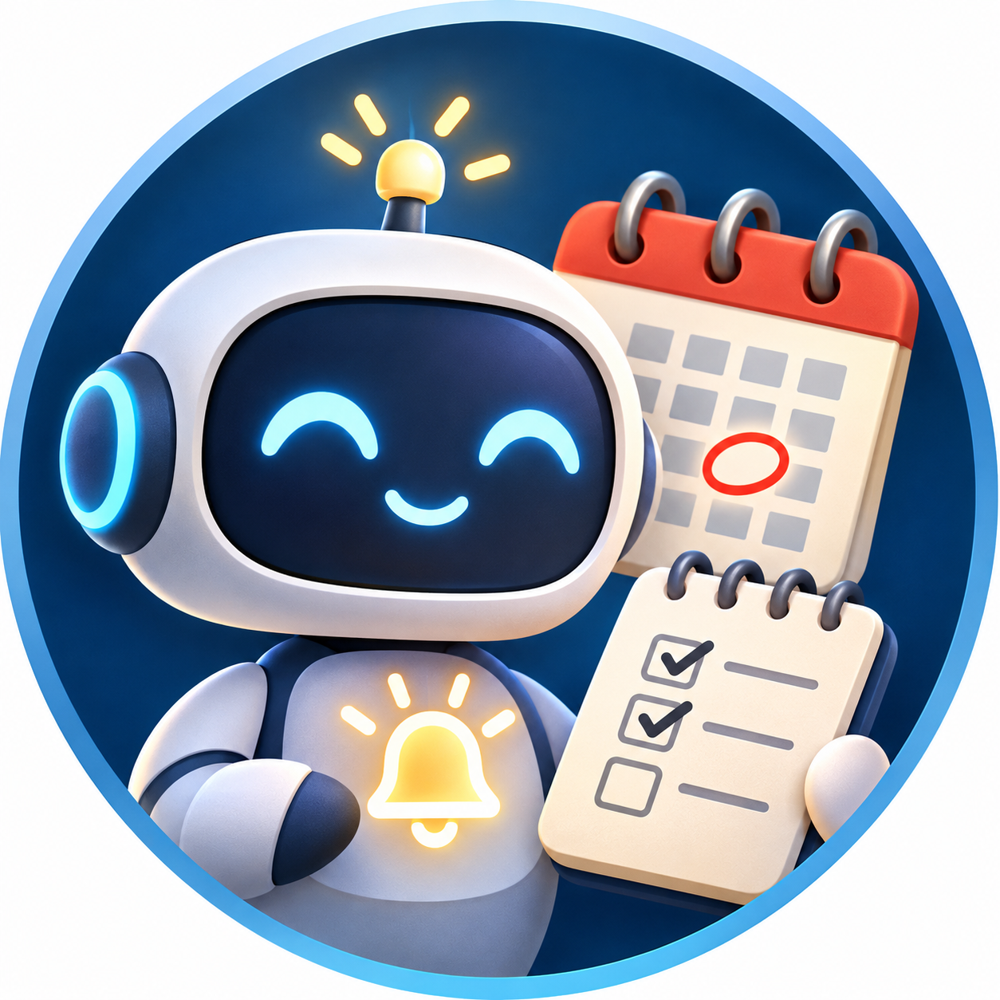
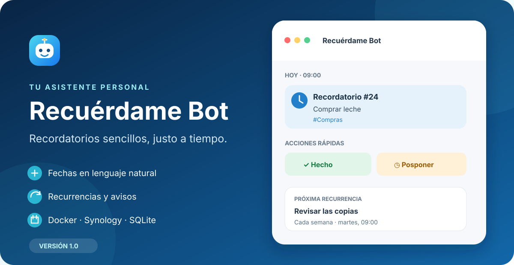

<p align="center">
  <a href="assets/bot.png"></a><br>
  <em>Avatar del bot: puedes descargarlo y usarlo en @BotFather.</em>
</p>

# 🤖 Recuérdame Bot

<p align="center">
  <strong>Tu asistente personal de recordatorios en Telegram.</strong><br>
  Fechas naturales, recurrencias, notas y alertas para tu NAS, en un bot ligero con Docker.
</p>

<p align="center">
  
  
  
  <a href="https://hub.docker.com/r/valkm/recuerdame_bot"></a>
  <a href="LICENSE"></a>
</p>

<p align="center">
  
</p>

## ✨ Qué puedes hacer

| 📝 Recordatorios | 🔁 Recurrencias | 🏷️ Organización |
| --- | --- | --- |
| Escribe «recuérdame comprar leche mañana a las 18:30». | Diarias, semanales o mensuales; puedes pausar o cambiar la frecuencia. | Añade etiquetas, notas y enlaces a cada tarea. |

| 🔔 Seguimiento | 🔗 Enlaces | 📊 Historial |
| --- | --- | --- |
| Repite avisos sin respuesta con límites configurables. | Comparte URL y consulta la información disponible del lanzamiento. | Revisa acciones recientes y estadísticas de actividad. |

La imagen es una **maqueta ilustrativa**: muestra ejemplos inventados, no datos ni capturas de conversaciones reales.

## 🚀 Inicio rápido

```bash
git clone https://github.com/AntonioM-D/recuerdame_bot.git
cd recuerdame_bot
cp .env.example .env
# Edita .env con tu token, tus ID autorizados y un secreto propio.
mkdir -p data
docker compose pull
docker compose up -d
```

La imagen multi-arquitectura está publicada en [Docker Hub](https://hub.docker.com/r/valkm/recuerdame_bot). Compose descargará la variante compatible con tu NAS.

### Ejemplo Compose usando directamente Docker Hub

Si quieres crear tu propio `docker-compose.yml` sin clonar el repositorio, puedes partir de este ejemplo. Crea un archivo `.env` con `BOT_TOKEN`, `ALLOWED_USER_IDS` y `ALERT_API_TOKEN`; puedes copiar `.env.example` como plantilla.

```yaml
services:
  mibot:
    image: valkm/recuerdame_bot:latest
    restart: unless-stopped
    env_file:
      - .env
    environment:
      TZ: Europe/Madrid
    volumes:
      - ./data:/app/data
    ports:
      - "127.0.0.1:8787:8080"
```

Desde esa carpeta, arranca el bot con:

```bash
mkdir -p data
docker compose pull
docker compose up -d
```

Para fijar una versión, cambia `latest` por la etiqueta deseada, por ejemplo `valkm/recuerdame_bot:v1.0`.

Abre el bot en Telegram y envía `/menu`. La guía de instalación completa y la configuración de Synology están más abajo.

**Versión documentada:** v1.0 · Consulta el [historial de cambios](CHANGELOG.md).

## Funciones

- Crear recordatorios escribiendo en lenguaje natural o con `/recordar`.
- Repeticiones diarias, semanales y mensuales, con opciones para pausar, reactivar y cambiar la frecuencia.
- Botones para completar, posponer o cancelar un recordatorio; las repeticiones de avisos sin respuesta se pueden configurar.
- Notas, etiquetas y enlaces asociados a recordatorios.
- Detección de información de lanzamientos al enviar algunas URL compatibles. La fecha extraída depende del contenido y los metadatos públicos de cada sitio; conviene confirmarla antes de crear el recordatorio.
- Menú interactivo en Telegram mediante `/menu` y menú de comandos nativo.
- Historial y resumen de actividad.
- API HTTP local para enviar alertas desde scripts y otros contenedores.
- Aviso a los usuarios autorizados cuando el bot arranca, con versión y hora.

## 📦 Requisitos

- Docker Engine y Docker Compose.
- Un bot de Telegram creado mediante [@BotFather](https://t.me/BotFather).
- El ID numérico de cada usuario autorizado.

## 🐳 Instalación con Docker Compose

1. Copia o clona este repositorio en una carpeta del servidor. En Synology, por ejemplo, `/volume1/docker/recuerdame-bot`.
2. En esa carpeta, crea tu configuración a partir del ejemplo:

   ```bash
   cp .env.example .env
   ```

3. Edita `.env` y sustituye el token de BotFather, los ID autorizados y el secreto de la API. No compartas ni publiques `.env`.
4. Crea la carpeta persistente y arranca el servicio:

   ```bash
   mkdir -p data
   docker compose pull
   docker compose up -d
   ```

   En Synology quizá necesites ajustar los permisos de `data` para el UID `10001`, que es el usuario sin privilegios utilizado en el contenedor:

   ```bash
   sudo chown -R 10001:10001 data
   ```

5. Revisa el estado y los registros:

   ```bash
   docker compose ps
   docker compose logs --tail=50 mibot
   ```

6. Abre el bot en Telegram y envía `/start` o `/menu`.

El bot usa long polling: no requiere dominio, certificado HTTPS ni puertos entrantes en el router. La API se publica por defecto solo en `127.0.0.1:8787` del host.

## ⚙️ Configuración

| Variable | Obligatoria | Valor inicial | Descripción |
| --- | --- | --- | --- |
| `BOT_TOKEN` | Sí | — | Token del bot emitido por BotFather. |
| `ALLOWED_USER_IDS` | Sí | — | ID o lista de ID de Telegram separados por comas. Solo estos usuarios pueden usar el bot y recibir alertas. |
| `ALERT_API_TOKEN` | Sí | — | Secreto de acceso a la API de alertas. Usa una cadena larga y aleatoria. |
| `DOCKERHUB_IMAGE` | No | `valkm/recuerdame_bot:latest` | Imagen multi-arquitectura descargada por Compose. |
| `TIMEZONE` | No | `Europe/Madrid` | Zona horaria para fechas y horas de recordatorios. |
| `TZ` | No | `Europe/Madrid` | Zona horaria del contenedor. |
| `API_BIND_PORT` | No | `8787` | Puerto del host enlazado solo a loopback. |
| `API_HOST` | No | `0.0.0.0` | Interfaz donde escucha la API dentro del contenedor. |
| `API_PORT` | No | `8080` | Puerto interno de la API. |
| `DB_PATH` | No | `/app/data/mibot.db` | Ruta de SQLite dentro del contenedor. |
| `REMINDER_REPEAT_MINUTES` | No | `30` | Minutos entre avisos persistentes (admite de 5 a 1440). |
| `REMINDER_MAX_RETRIES` | No | `3` | Número máximo de reintentos (admite de 0 a 10; `0` los desactiva). |
| `LOG_LEVEL` | No | `INFO` | Nivel de registro, por ejemplo `INFO` o `DEBUG`. |

Para más de un usuario, escribe los ID separados por comas, por ejemplo `111111111,222222222`. No uses nombres de usuario como sustituto de los ID.

## ⌨️ Comandos de Telegram

| Comando | Uso |
| --- | --- |
| `/menu` | Abrir el menú interactivo. |
| `/start` | Abrir el menú interactivo (alias; se mantiene disponible aunque no aparezca en la lista nativa). |
| `/help` | Ver ayuda y ejemplos. |
| `/recordar` | Crear un recordatorio. También puedes enviar directamente el texto sin comando. |
| `/lista [#etiqueta]` | Ver recordatorios activos o filtrarlos por etiqueta. |
| `/hoy` | Ver los recordatorios de hoy. |
| `/semana` | Ver los previstos en los próximos siete días. |
| `/proximos` | Ver los próximos recordatorios. |
| `/cancelar ID` | Cancelar un recordatorio o detener una recurrencia conservando el historial. |
| `/pausar ID` | Pausar una recurrencia. |
| `/reactivar ID` | Reactivar una recurrencia pausada. |
| `/frecuencia ID diaria\|semanal\|mensual` | Cambiar la periodicidad de una recurrencia; se aplica después de completar la ocurrencia actual. |
| `/nota ID texto` | Añadir o cambiar la nota. Usa `/nota ID borrar` para quitarla. |
| `/etiqueta ID #Libros #Casa` | Reemplazar las etiquetas del recordatorio. Usa `/etiqueta ID borrar` para eliminarlas todas. |
| `/historial [límite]` | Consultar las últimas acciones (límite de 1 a 20; por defecto 15). |
| `/estadisticas [días]` | Resumen de actividad (de 1 a 365 días; por defecto 30). |
| `/estado` | Consultar el estado y la configuración de avisos persistentes. |
| `/salir` | Salir de una acción guiada en curso. |

Ejemplos:

```text
Recuérdame comprar leche mañana a las 18:30
/recordar renovar certificado dentro de 20 días
/recordar revisar copias cada semana #NAS nota: comprobar el último backup
/lista #NAS
/nota 12 descargar en epub
/etiqueta 12 #Libros
/etiqueta 12 borrar
```

Si no indicas una hora, el bot usa las 09:00 en la zona horaria configurada.

## 🔌 API local de alertas

Desde el propio servidor, envía un aviso con:

```bash
set -a
. ./.env
set +a

curl -X POST "http://127.0.0.1:${API_BIND_PORT:-8787}/notify" \
  -H "Authorization: Bearer $ALERT_API_TOKEN" \
  -H "Content-Type: application/json" \
  -d '{"title":"NAS","message":"El backup ha terminado","severity":"info"}'
```

La API admite `info`, `warning` y `critical`; el título y el mensaje son obligatorios. El endpoint `/health` sirve para comprobar que la API está activa:

```bash
curl "http://127.0.0.1:${API_BIND_PORT:-8787}/health"
```

El puerto solo está publicado en loopback por defecto. Para que otro contenedor acceda a la API, ambos servicios deben compartir una red Docker y ese contenedor debe usar `http://mibot:8080/notify` junto con el token. No publiques el puerto interno directamente en Internet.

## 💾 Datos, copias y actualización

La base SQLite vive en `data/` y persiste al recrear el contenedor. La carpeta contiene datos personales: no se incluye en Git. Haz una copia antes de actualizar o migrar el NAS. Para una copia SQLite consistente mientras el bot está en uso, puedes usar la API de backup integrada de Python dentro del contenedor:

```bash
stamp=$(date +%Y%m%d-%H%M%S)
docker compose exec -T -e BACKUP="/app/data/mibot-backup-$stamp.sqlite3" mibot \
  python -c 'import os, sqlite3; src=sqlite3.connect("/app/data/mibot.db"); dst=sqlite3.connect(os.environ["BACKUP"]); src.backup(dst); dst.close(); src.close(); print("Copia creada:", os.environ["BACKUP"])'
```

Para actualizar a la imagen publicada más reciente, sin borrar `data/`:

```bash
docker compose pull
docker compose up -d
```

Si prefieres construir desde el código fuente, usa el archivo adicional:

```bash
docker compose -f docker-compose.yml -f docker-compose.source.yml up -d --build
```

## 🔐 Seguridad

- **Protege tus credenciales:** no publiques `.env`, tokens ni ID privados. `.gitignore` excluye la configuración local, la base de datos y sus copias.
- **API local:** requiere `ALERT_API_TOKEN` y se publica solo en `127.0.0.1` del host por defecto. No expongas el puerto directamente a Internet.
- **Acceso limitado:** el bot solo acepta mensajes de los ID incluidos en `ALLOWED_USER_IDS`.
- **Docker aislado:** el contenedor no monta el socket de Docker ni puede administrar otros contenedores.
- **Una instancia por token:** ejecuta un solo proceso de polling para cada bot de Telegram.

## 📄 Licencia

Este proyecto se distribuye bajo la licencia [MIT](LICENSE), que permite usarlo, modificarlo y redistribuirlo conservando el aviso de copyright y la licencia.

📘 **Manual detallado:** [descargar la guía de comandos en PDF](docs/manual-comandos.pdf).
